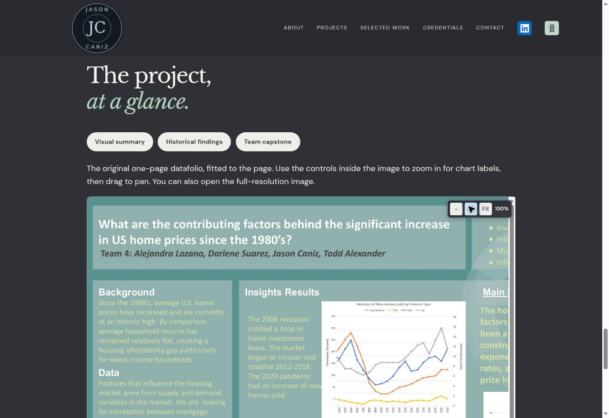

# Website implementation review

Branch: `correlation-one-march-implementation`

Production baseline: `4f2384c4f5c1c76beab186d65c656e7df5569603`. Previous versions remain in Git history. No production merge or deployment has occurred.

## Changes

- Update the three supplied case-study pages while preserving the existing employer card, brand, navigation, and supporting capstone assets.
- Preserve the supplied revised PDF unchanged, with visible viewing and download links. The editable Word source is excluded from the public branch.
- Feature Power BI and Tableau dashboard images, supplementary chart images and workflow diagrams. Power BI is a static image, with image zoom and pan rather than live report interaction.
- Add top-of-page section shortcuts to the six current case-study pages. Homepage layout remains unchanged; its badge labels are included in the uniqueness audit.
- Add compact zoom controls inside analytical images. Dragging pans zoomed images. Fit resets the image position. Original-image links remain available.
- Preserve all PDFs and the existing report viewer behavior.

## Review locally

Download this branch as a ZIP from GitHub and extract it. In that folder, run:

```bash
python3 -m http.server 8000
```

Open `http://localhost:8000/`, expand the Correlation One card, and visit all three pages. Inspect the section shortcuts on the Amazon, Google and Mr. E pages too.

On the capstone page, choose Datafolio. Select +, drag the image, and select Fit. The dashboard and workflow images have the same controls. Original PDFs remain linked separately.

## Validation

- Checked 223 local href/src/poster references across the homepage, six case studies and legacy landing page. No missing files or fragment targets.
- Checked duplicate IDs, image alt attributes and H1 counts.
- Browser viewport checks at 390, 768 and 1440 pixels for all six case studies: no page-wide overflow. Narrow-screen menu open/close and section navigation tested.
- Opened the revised PDF in Chrome and rendered both pages with Poppler. The original report remains unchanged.
- Tested report page-turn and zoom controls without changing their code.
- Tested image zoom, horizontal and vertical mouse dragging, and Fit resetting both scroll offsets. Controls fit inside the narrow viewport. Desktop control bar measures 145 by 40 pixels, with larger touch targets on touchscreens.
- JavaScript syntax checks pass for script.js, capstone-documents.js, amazon-connected.js and simulation-frames.js. No first-party JavaScript errors observed during tested browser flows.
- styles.css, brand-system.css, script.js, original PDFs and capstone media are unchanged. Only image-viewer code is extended in capstone-documents.js; report-viewer code is unchanged.

## Limits

No live Power BI embed is implemented. External embed controls were not exhaustively retested. Responsive checks used browser viewports, not a physical mobile device. Touchscreen gestures and other browser engines remain untested.

## Review image



## Power-word labels

Use exactly three badges in each selected section, and only two or three selected sections per project. Every badge label must be unique across the current website. Keep each label beside the strongest supporting evidence.

Validated 66 badges with 66 unique labels across the homepage, six current case studies and Correlation One overview. Each case study and the homepage use three selected badge sections; the short overview retains one three-badge summary. Removed badge groups from the other sections without changing their narrative content, navigation or media.

## Operations case-study framing

Present Distinguished Scholar Selection as an additional operations case study completed for Correlation One. Apply this wording to the homepage card, case-study introduction, metadata, overview and related navigation. Original source PDFs are preserved unchanged.
